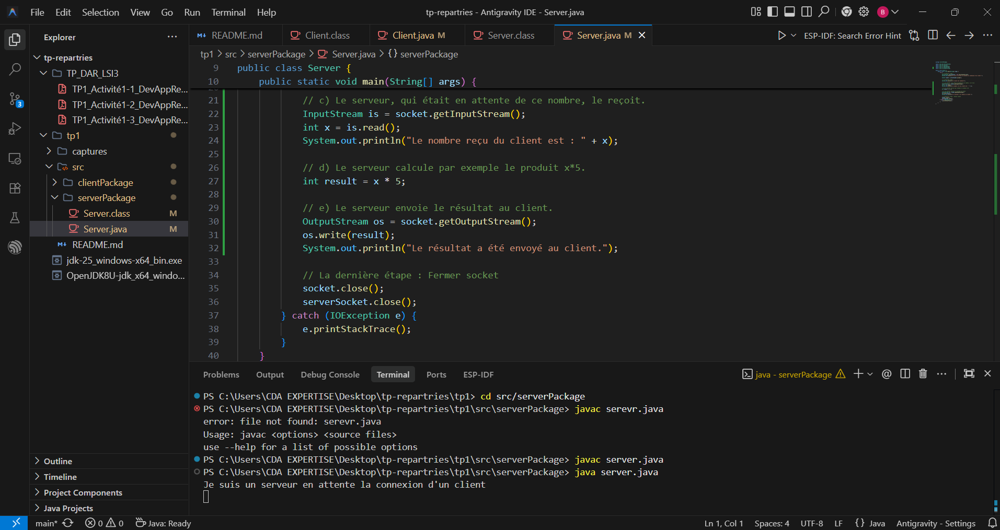
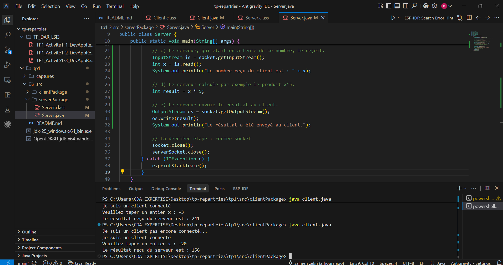
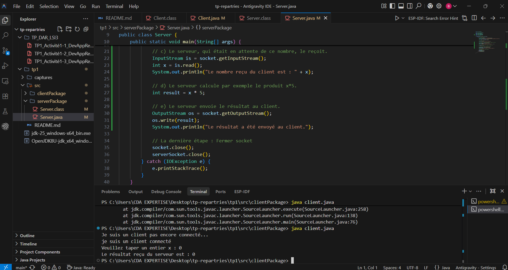
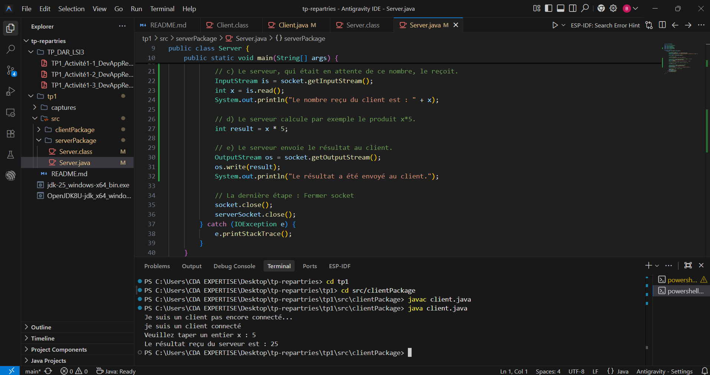
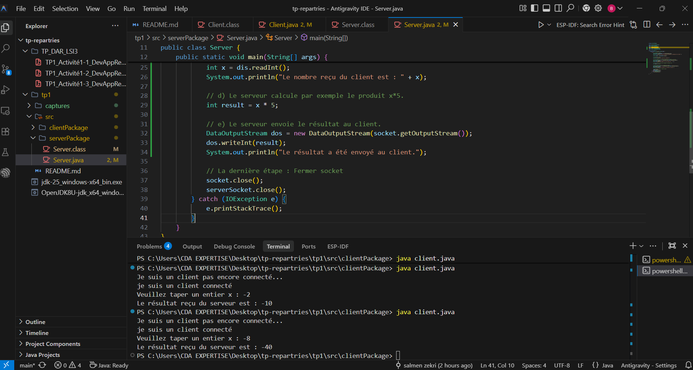
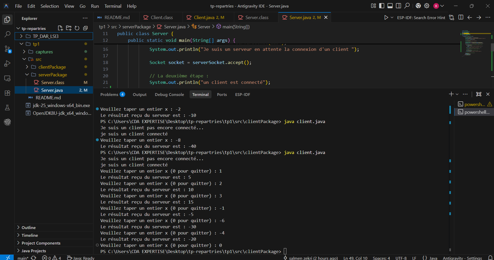
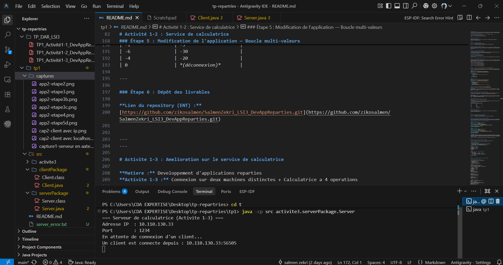
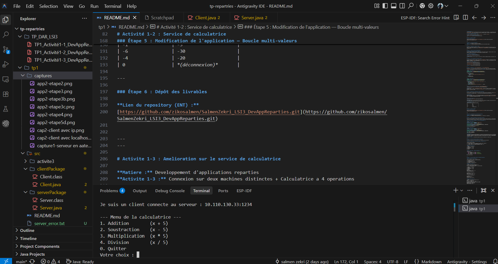
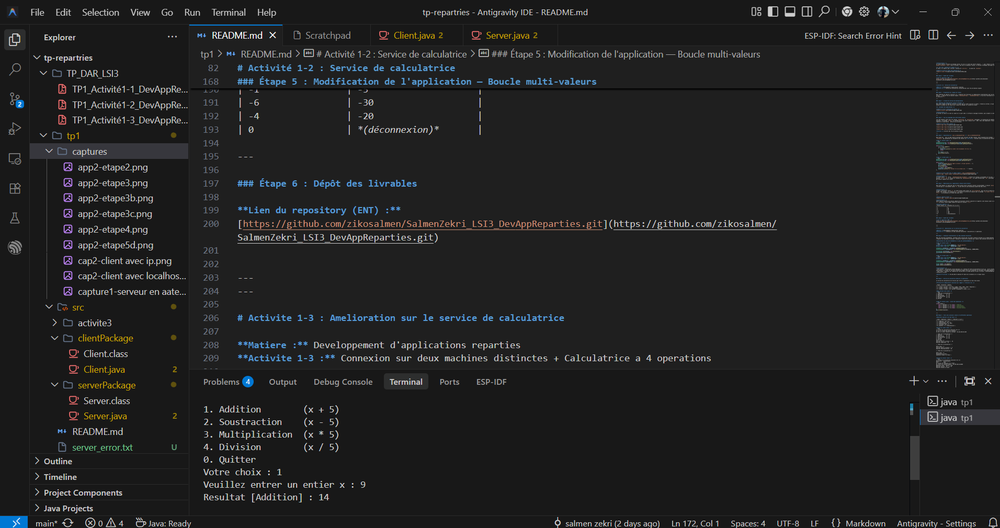
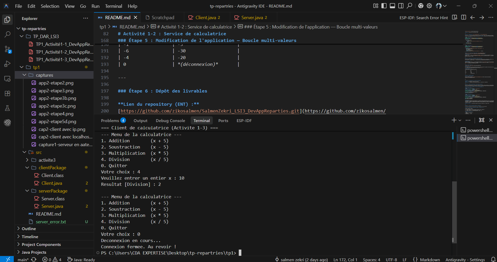

# TP1 : Les sockets en mode connecté TCP

**Matière :** Développement d’applications réparties
**Activité 1-1 :** Première connexion Client/Serveur

---

### Étape 1 : Préparation de l’environnement Git

**Commande exécutée :**
```powershell
git --version
```
**Capture d'écran (Résultat Console) :**
```text
git version 2.x.x.windows.x
```

---

### Étape 2 : Préparation de l’environnement Java

**Commande exécutée :**
```powershell
java --version
```
**Capture d'écran (Résultat Console) :**
```text
java 25.0.4.1 2026-08-18 LTS
Java(TM) SE Runtime Environment (build 25.0.4.1+1-LTS-5)
Java HotSpot(TM) 64-Bit Server VM (build 25.0.4.1+1-LTS-5, mixed mode, sharing)
```

---

### Étape 3 : Création du serveur

Nous avons créé le package `serverPackage` contenant la classe `Server.java`.

**Lancement du serveur :**
```powershell
java -cp src serverPackage.Server
```

**Capture d'écran :**


**Interprétation :**
Le serveur s'est lancé avec succès. Il s'est mis en écoute sur le port 1234 (`ServerSocket.accept()`). Dès que l'application cliente s'est connectée, le serveur a accepté la connexion et a affiché "un client est connecté" avant de fermer les sockets.

---

### Étape 4 : Création du client

Nous avons créé le package `clientPackage` contenant la classe `Client.java`.

**1. Test avec `localhost` :**
Le client se connecte d'abord au serveur en utilisant `localhost`.

**Capture d'écran du client avec localhost :**


**Interprétation :**
Le client démarre, affiche son message initial "Je suis un client pas encore connecté...", puis établit la connexion TCP (`new Socket("localhost", 1234)`) avec le serveur. Une fois la connexion réussie, il affiche le message confirmant sa connexion.

**2. Test avec l'adresse IP (Étape 4.f) :**
Le code a été modifié pour utiliser l'adresse IP `127.0.0.1` à la place de `localhost`.

**Capture d'écran du client avec adresse IP :**


---

### Étape 5 : Dépôt des livrables

**Lien du repository (ENT) :**
[https://github.com/zikosalmen/SalmenZekri_LSI3_DevAppReparties.git](https://github.com/zikosalmen/SalmenZekri_LSI3_DevAppReparties.git)

---
---

# Activité 1-2 : Service de calculatrice

**Matière :** Développement d'applications réparties
**Activité 1-2 :** Service de calculatrice (Client/Serveur avec flux de données typées)

---

### Étape 1 : Préparation de l'espace de travail

Nous repartons du code de l'Activité 1-1. L'objectif est d'enrichir la communication Client/Serveur pour qu'elle échange des entiers à l'aide de flux de données typées (`DataInputStream` / `DataOutputStream`), et qu'elle fonctionne en boucle jusqu'à la saisie de `0`.

---

### Étape 2 : Création du service de multiplication

**1. Extension des applications Client et Serveur :**
Nous avons étendu le code de l'Activité 1-1 pour que le client saisisse un entier, l'envoie au serveur, et que le serveur calcule le produit de cet entier par 5 avant de renvoyer le résultat au client.

**2. Lancement des applications :**

**Capture d'écran — Connexion du serveur :**


**Interprétation :**
Le serveur se lance et se met en écoute sur le port 1234. Il affiche le message d'attente, puis accepte la connexion du client.

---

### Étape 3 : Test du programme avec différentes valeurs

Lors des premiers tests avec les classes `InputStream` et `OutputStream` classiques, la transmission de nombres négatifs pose problème : la méthode `write()` ne transmet qu'un seul octet (valeurs de 0 à 255). Cela rend impossible l'envoi de valeurs négatives ou supérieures à 255 de façon correcte.

**Capture d'écran — Test initial :**






**Solution :** utiliser des flux de données typées.

---

### Étape 4 : Exploitation de `java.io.DataInputStream` et `java.io.DataOutputStream`

Nous avons mis à jour le code Client et Serveur pour utiliser ces deux classes. Elles disposent des méthodes `readInt()` et `writeInt()` qui permettent de transmettre des entiers sur **32 bits**, résolvant ainsi le problème des entiers négatifs.

**Code clé (Server.java) :**
```java
DataInputStream dis = new DataInputStream(socket.getInputStream());
DataOutputStream dos = new DataOutputStream(socket.getOutputStream());

while (true) {
    int x = dis.readInt();
    if (x == 0) {
        System.out.println("Le client s'est déconnecté (0 reçu).");
        break;
    }
    int result = x * 5;
    dos.writeInt(result);
}
```

**Code clé (Client.java) :**
```java
DataOutputStream dos = new DataOutputStream(socket.getOutputStream());
DataInputStream dis = new DataInputStream(socket.getInputStream());

while (true) {
    System.out.print("Veuillez taper un entier x (0 pour quitter) : ");
    int x = scanner.nextInt();
    dos.writeInt(x);
    if (x == 0) break;
    int result = dis.readInt();
    System.out.println("Le résultat reçu du serveur est : " + result);
}
```

**Capture d'écran — Test avec un nombre négatif (`java.io.DataOutputStream`) :**


**Interprétation :**
Le client saisit `-2`. Grâce à `DataOutputStream.writeInt()`, l'entier est transmis correctement sur 32 bits. Le serveur calcule `-2 × 5 = -10` et renvoie le résultat via `DataOutputStream`. Le client affiche bien `-10`, confirmant que le problème des entiers négatifs est résolu.

---

### Étape 5 : Modification de l'application — Boucle multi-valeurs

Nous avons modifié le code pour que le client puisse saisir plusieurs entiers successivement. La boucle `while (true)` ne s'arrête que si l'utilisateur saisit `0`, ce qui entraîne une déconnexion propre des deux côtés.


**Interprétation :**
Lorsque l'utilisateur saisit `0`, le client envoie cette valeur via `dos.writeInt(0)` puis sort de la boucle et ferme la socket. Côté serveur, la réception de `0` déclenche la sortie de la boucle avec le message `"Le client s'est déconnecté (0 reçu)."`. La déconnexion est propre des deux côtés.

---

**Session complète finale :**


**Interprétation :**
Cette capture illustre une session complète où plusieurs entiers (positifs et négatifs) sont envoyés avant la déconnexion avec `0`. Le serveur traite chaque requête en boucle et calcule `x × 5`.

**Résultats observés :**
| Entier envoyé (x) | Résultat reçu (x × 5) |
|:-----------------:|:---------------------:|
| 1                 | 5                     |
| 2                 | 10                    |
| 3                 | 15                    |
| -1                | -5                    |
| -6                | -30                   |
| -4                | -20                   |
| 0                 | *(déconnexion)*       |

---

### Étape 6 : Dépôt des livrables

**Lien du repository (ENT) :**
[https://github.com/zikosalmen/SalmenZekri_LSI3_DevAppReparties.git](https://github.com/zikosalmen/SalmenZekri_LSI3_DevAppReparties.git)


---
---

# Activite 1-3 : Amelioration sur le service de calculatrice

**Matiere :** Developpement d'applications reparties
**Activite 1-3 :** Connexion sur deux machines distinctes + Calculatrice a 4 operations

---

### Etape 1 : Connexion Client/Serveur sur deux machines distinctes

Dans les activites precedentes, localhost etait utilise pour les tests (Client et Serveur sur la meme machine).
L'objectif est desormais d'utiliser l'adresse IP reelle de la machine pour simuler deux machines distinctes du reseau local.

**Exploitation de java.net.InetAddress et java.net.InetSocketAddress :**

**Code cle (Server.java) :**
```java
private static final String SERVER_IP  = "10.110.130.33";
private static final int    SERVER_PORT = 1234;

InetAddress inetAddress = InetAddress.getByName(SERVER_IP);
InetSocketAddress socketAddress = new InetSocketAddress(inetAddress, SERVER_PORT);

ServerSocket serverSocket = new ServerSocket();
serverSocket.bind(socketAddress);
```

**Code cle (Client.java) :**
```java
private static final String SERVER_IP  = "10.110.130.33";
private static final int    SERVER_PORT = 1234;

InetAddress inetAddress = InetAddress.getByName(SERVER_IP);
InetSocketAddress socketAddress = new InetSocketAddress(inetAddress, SERVER_PORT);

Socket socket = new Socket();
socket.connect(socketAddress);
```

**Capture d'ecran — Serveur en attente de connexion :**


**Interpretation :**
- Cote serveur : ServerSocket ecoute desormais sur l'adresse IP reelle 10.110.130.33 et non sur 0.0.0.0 (toutes interfaces). Cela permet a un client sur une autre machine du reseau local de se connecter en utilisant cette meme adresse IP.
- Cote client : localhost est remplace par 10.110.130.33 (la meme adresse IP que le serveur). InetSocketAddress encapsule l'adresse et le port.

**Adresse IP utilisee :** 10.110.130.33 (adresse IP reelle de la machine sur le reseau local)

---

### Etape 2 : Service de calculatrice ameliore (4 operations)

Le service de calculatrice est enrichi pour offrir 4 operations au lieu d'une seule.

**Protocole de communication (evolution par rapport a l'Activite 1-2) :**

| Etape | Direction | Donnee |
|:-----:|:---------:|--------|
| 1 | Client → Serveur | int choix (1=Add, 2=Sub, 3=Mul, 4=Div, 0=Quitter) |
| 2 | Client → Serveur | int x (uniquement si choix != 0) |
| 3 | Serveur → Client | int resultat (uniquement si choix != 0) |

**Menu affiche cote Client :**
```text
--- Menu de la calculatrice ---
1. Addition        (x + 5)
2. Soustraction    (x - 5)
3. Multiplication  (x * 5)
4. Division        (x / 5)
0. Quitter
```

**Code cle (Server.java) - switch des operations :**
```java
switch (choix) {
    case 1: resultat = x + 5; break; // Addition
    case 2: resultat = x - 5; break; // Soustraction
    case 3: resultat = x * 5; break; // Multiplication
    case 4: resultat = x / 5; break; // Division entiere
}
dos.writeInt(resultat);
```

**Capture d'ecran — Cote Client connecte (menu affiché) :**


---

### Etape 3 : Tests avec plusieurs valeurs et differentes operations

**Resultats observes lors des tests :**

| Choix | Operation | Valeur x | Resultat (x op 5) |
|:-----:|:---------:|:--------:|:-----------------:|
| 1 | Addition | 10 | 15 |
| 2 | Soustraction | 20 | 15 |
| 3 | Multiplication | 6 | 30 |
| 4 | Division | 25 | 5 |
| 0 | Quitter | — | *(deconnexion)* |

**Sortie du client (test) :**
```text
=== Client de calculatrice (Activite 1-3) ===
Je suis un client pas encore connecte...
Je suis un client connecte au serveur : 10.110.130.33:1234

--- Menu de la calculatrice ---
1. Addition        (x + 5)
2. Soustraction    (x - 5)
3. Multiplication  (x * 5)
4. Division        (x / 5)
0. Quitter
Votre choix : 1
Veuillez entrer un entier x : 10
Resultat [Addition] : 15

--- Menu de la calculatrice ---
...
Votre choix : 3
Veuillez entrer un entier x : 6
Resultat [Multiplication] : 30

--- Menu de la calculatrice ---
...
Votre choix : 0
Deconnexion en cours...
Connexion fermee. Au revoir !
```

**Capture d'ecran — Client : saisie Addition (x=9, resultat=14) :**


**Capture d'ecran — Client : Division puis Quitter :**


**Sortie du serveur (test) :**
```text
=== Serveur de calculatrice (Activite 1-3) ===
Adresse IP  : 10.110.130.33
Port        : 1234
En attente de connexion d'un client...
Un client est connecte depuis : 10.110.130.33:64555
Operation recue : choix=1, x=10
Resultat calcule : 10 + 5 = 15
Resultat envoye au client.
Operation recue : choix=3, x=6
Resultat calcule : 6 * 5 = 30
Resultat envoye au client.
Le client a demande la deconnexion (choix = 0).
Serveur ferme proprement.
```

**Interpretation :**
- Le serveur ecoute sur l'adresse IP 10.110.130.33, ce qui permet la connexion depuis toute machine du meme reseau local.
- Le client affiche un menu interactif et envoie d'abord le choix d'operation, puis la valeur x.
- Le serveur recoit le choix, recoit x, calcule le resultat selon l'operation choisie, et renvoie le resultat.
- La deconnexion propre est conservee : le choix  suffit a terminer la session des deux cotes.

---

### Etape 4 : Commandes de compilation et d'execution

**Compilation :**
```powershell
javac -encoding UTF-8 -cp src src\activite3\serverPackage\Server.java src\activite3\clientPackage\Client.java
```

**Lancement du Serveur :**
```powershell
java -cp src activite3.serverPackage.Server
```

**Lancement du Client (dans un autre terminal) :**
```powershell
java -cp src activite3.clientPackage.Client
```

---

### Etape 5 : Depot des livrables

**Lien du repository (ENT) :**
[https://github.com/zikosalmen/SalmenZekri_LSI3_DevAppReparties.git](https://github.com/zikosalmen/SalmenZekri_LSI3_DevAppReparties.git)